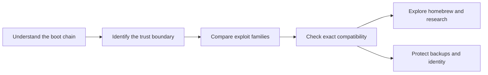

# Xbox 360 Field Guide

A guide to Xbox 360 homebrew: the boot chain, the major public exploit families, Peer Pressure, PeerSlop, NAND research, and homebrew capabilities. Read the same Markdown here on GitHub or through the static website.

> **AI-assisted · Educational only · Independent community research**
> Written with help from AI. This project is not affiliated with, endorsed by, or sponsored by M$ or the Xbox team. Reading or using this repository assumes you know what you are doing. You take responsibility for your own actions; **s33g accepts no responsibility for anything done with this material**, including damage, data loss, account restrictions, or other consequences. See the [full notice](docs/NOTICE.md).

## Contents

| If you want to… | Start here |
|---|---|
| Understand the vocabulary and avoid common mix-ups | [Start here](docs/START_HERE.md) |
| See how the console decides what to trust | [Inside the boot chain](docs/BOOT_CHAIN.md) |
| Compare the major Xbox 360 exploits | [Exploit atlas](docs/XBOX360_MODDING.md) |
| Follow the history | [Exploit timeline](docs/EXPLOIT_TIMELINE.md) |
| Understand the persistent software route | [Peer Pressure](docs/PEER_PRESSURE_GUIDE.md) |
| Compare routes and constraints | [Choosing a homebrew path](docs/BETTER_SOFTMOD.md) |
| Learn what comes after code execution | [Homebrew, kernels and Linux](docs/CUSTOM_FIRMWARE.md) |
| Read NAND research without exposing a console | [NAND explained](docs/NAND_EXPLAINED.md) · [Privacy](docs/PRIVACY.md) |
| Work as an agent or contribute | [Agent reading guide](docs/FOR_AGENTS.md) · [Maintaining the guide](docs/MAINTAINING.md) |
| Install the research workflows in an agent tool | [Seven portable agent skills](docs/AGENT_SKILLS.md) |
| Find definitions and original work | [Glossary](docs/GLOSSARY.md) · [Sources and thanks](docs/CREDITS.md) |

## Reading order



The chapters explain mechanisms and limitations. The guide does not include automated installers or exploit payloads. The atlas covers the major documented public families and distinguishes variants from separate vulnerabilities; it is not a claim to catalogue every private exploit or save-game port.

## Read on the web

The repository includes a static site generator, local search, a dark/light theme, and Mermaid rendering. The HTML is readable without JavaScript; diagrams keep their textual description and source as a fallback. Every chapter has GitHub and raw Markdown links. The chapters, search, Mermaid renderer and homepage model use locally bundled assets. The model is credited to its creator and is optional for reading the guide.

To build and preview **only the documentation website** with Node.js 22 or newer:

```sh
npm ci
npm run check
npm run build
npm run preview
```

Open the local address printed by the preview command. The generated `dist/` folder works on a static host, including a GitHub Pages project path. [Hosting instructions](docs/MAINTAINING.md) cover the included workflow. These commands do not run an exploit or connect to a console.

## Research tools and privacy

The [NAND inspector](docs/NAND_ANALYZER.md) runs entirely in your browser, with an interactive block map and a synthetic demo. Download a standalone offline HTML file, Node CLI or reusable parser from the web edition. All three share one TypeScript core. The [analysis skill](skills/xbox360-nand-analysis/SKILL.md) carries the Node program and agent instructions. The old console-specific experiments have been retired.

CPU keys, DVD keys, console IDs, serials, NAND images, decrypted Keyvaults and generated reports belong outside this repository. **Analyzer output can contain sensitive console information; treat it as private even when redacted.** This preserves the original research warning, rather than implying an analysis report is safe to publish.

## Credits and scope

Special thanks to **Grimdoomer** for [Peer Pressure](https://github.com/grimdoomer/Xbox360PeerPressure), and **DarkLimbo / darkkiritov** for [PeerSlop](https://gitlab.com/darkkiritov/peerslop). The [dedicated chapter](docs/PEER_PRESSURE_GUIDE.md) explains their relationship and different source availability. Thanks also to the researchers, tool authors and testers credited in [Sources and thanks](docs/CREDITS.md).

The guide was cross-checked against [ConsoleMods](https://consolemods.org/wiki/Xbox_360:Xbox_360_Mods_Wiki), with direct references in the chapters and [source register](docs/CREDITS.md#consolemods-reference-register). Original developer sources remain linked for release-specific details.

Current project claims were reviewed on **29 October 2026**. Upstream releases change; verify the exact release before relying on compatibility. No new license is granted by this cleanup; third-party work keeps its own license, and this repository currently has no general license grant.
