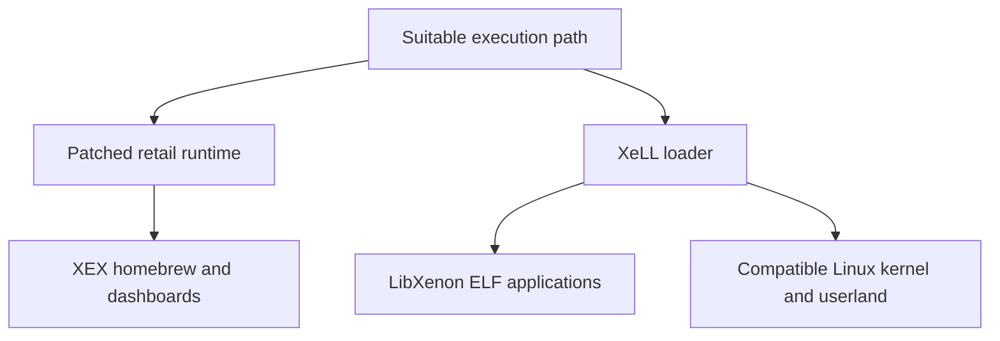

# Homebrew, kernels and Linux

Getting code to run is the beginning. What runs next depends on the environment it expects: a patched version of the console's normal runtime, a small bare-metal loader, or an alternative operating system.

## Three environments

The arrows show conceptual routes, not a guarantee that every exploit or release supports every destination.

| Environment | What it offers | Main limitation |
|---|---|---|
| Patched retail runtime | Homebrew that expects Xbox system services; alternative launchers and utilities | Application and plugin compatibility depends on the patch set |
| XeLL + LibXenon | ELF loading and a community bare-metal development environment | A different API and driver environment from retail XEX software |
| Linux | A general-purpose environment for experiments and software porting | Hardware support, memory, architecture and distribution compatibility still matter |

[XeLL-Reloaded](https://github.com/Free60Project/xell-reloaded) loads ELF programs and provides Linux boot information. [LibXenon](https://github.com/Free60Project/libxenon) is the open community library and toolchain for bare-metal homebrew. Neither name means “an exploit that works on any stock console.”

The [ConsoleMods XeLL guide](https://consolemods.org/wiki/Xbox_360:XeLL) provides a practical overview of the loader and its variants. Its discussion assumes a compatible modified environment; finding an ELF file does not establish a boot path for a particular console.

## What “custom firmware” can mean

Scene discussions often use one phrase for different things: a modified flash image, patches applied to the running kernel, or modified optical-drive firmware. These change different trust boundaries. A drive firmware modification does not by itself provide the same CPU-side environment as a homebrew-capable kernel. See [the exploit atlas](XBOX360_MODDING.md).

Likewise, a custom dashboard is a user interface, not an operating-system replacement. The [ConsoleMods dashboard overview](https://consolemods.org/wiki/Xbox_360:Dashboards_Overview) compares examples such as Aurora, Freestyle Dash and XeXMenu. A plugin loader is an integration mechanism, not automatic compatibility with every plugin. Use the [software feature comparison](BETTER_SOFTMOD.md#compare-the-software-environments) and [Peer Pressure guide](PEER_PRESSURE_GUIDE.md) to check what each environment actually includes.

## What to explore

**Original homebrew.** Small games, visual experiments, controller tools and educational programs are good ways to understand an unfamiliar platform. The [ConsoleMods homebrew app list](https://consolemods.org/wiki/Xbox_360:Homebrew_Apps_List) is a useful discovery index. Read the project's source, build requirements and license before treating a downloadable executable as trusted.

**Emulation.** An emulator needs a suitable CPU, graphics path and runtime. Compatibility is per emulator and often per title; “the console is modified” is not a performance guarantee. Supply your own lawful software and assets. This guide does not distribute games, firmware or proprietary SDK material.

**Linux.** The [Free60 kernel patch repository](https://github.com/Free60Project/linux-kernel-xbox360) contains Xbox 360 support work. The [Free60 Debian research guide](https://free60.org/Linux/Distros/Debian/sid/) describes modern PowerPC experiments and warns that the setup is evolving. Confirm the kernel patch, toolchain and userland as a set. Do not assume a mainstream desktop installer supports this machine.

The [ConsoleMods Linux walkthrough](https://consolemods.org/wiki/Xbox_360:Linux), checked 29 October 2026, describes an older Ubuntu 10.10 Xenon Beta 5 setup through XeLL/XellLaunch. Read it as a historical example, not evidence that a current Ubuntu image or every modern softmod can boot Linux.

**Preservation and diagnostics.** Understanding file formats, documenting behavior and building reproducible tools are useful goals in their own right. Work on copies, keep console identity private, and label synthetic test fixtures clearly.

## Why a PC operating system is not a drop-in upgrade

Software built for a different CPU architecture cannot run natively just because signature checks have changed. A useful port also needs a boot path, drivers and an ABI-compatible userland. Emulation is a separate engineering project with its own performance constraints. Avoid claims that a homebrew exploit turns an Xbox 360 into a current desktop PC.

Next: [Choosing a homebrew path](BETTER_SOFTMOD.md) · [Sources and thanks](CREDITS.md).
