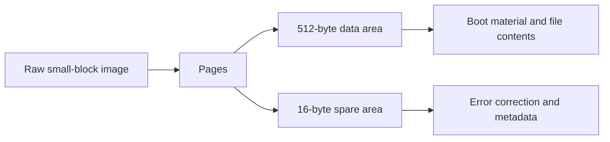

# NAND explained

NAND is non-volatile flash storage. On many Xbox 360 revisions it holds boot material, system files and console-specific data. A NAND dump is a snapshot of that storage—not a portable firmware image you can freely exchange between consoles.

This chapter replaces a private-console case study. It deliberately contains no console identity table, sample bytes from a Keyvault, unique bad-block map or claims that a particular owner's installation has been verified.

## Identify the storage first

ConsoleMods separates [standard NAND](https://consolemods.org/wiki/Xbox_360:Standard_NAND) from [4 GB Corona-family storage](https://consolemods.org/wiki/Xbox_360:4GB_NAND). A "4 GB Xbox 360" label alone does not identify the system-flash format: Trinity's 4 GB user storage is a separate memory unit, while later boards can combine system and user storage behind a flash controller. Check the board and storage arrangement before selecting a parser. [Motherboard reference](https://consolemods.org/wiki/Xbox_360:Motherboard_Information).

## Data plus bookkeeping

A common small-block layout has 512 bytes of data followed by 16 spare bytes per page. Those spare bytes hold error-correction and controller metadata. With 32 pages per block, that is 16 KiB of data, or 16,896 bytes including spare areas. A 16 MiB data image becomes 17,301,504 bytes when all of those spare areas are present. Larger NAND and eMMC layouts need different handling. [Free60 NAND reference](https://free60.org/Hardware/Console/NAND/).



For that layout only, a data offset maps into a raw image using:

```text
raw offset = floor(data offset / 512) × 528 + (data offset mod 512)
```

A raw offset inside spare data has no equivalent ordinary data byte. Stripping spare regions before understanding the format can discard the very metadata your analysis needs.

## What lives there

| Area | What to learn | What to avoid assuming |
|---|---|---|
| Flash header | How later structures are located | One sample's offsets apply to every image |
| SMC image and configuration | Separate controller firmware and settings | A readable signature proves the full modification type |
| Bootloaders | Stage identity, versions, console-specific relationships | A version string alone proves exploit eligibility |
| Keyvault | Encrypted console identity and pairing material | Encryption makes a dump safe to publish |
| Flash filesystem | System-file storage and generations | The newest-looking filename is the active file |
| Spare and remap metadata | How logical storage survives bad physical blocks | A factory bad block means the image needs repair |

Implementation details should be checked against a maintained parser such as [J-Runner with Extras](https://github.com/J-Runner-With-Extras/J-Runner-with-Extras), with attention to the exact revision and geometry supported.

The CPU key and Keyvault are different things. The CPU key comes from CPU fuse data and protects the encrypted Keyvault; it is not a field stored inside the Keyvault. [Free60's fuse reference](https://free60.org/Hardware/Fusesets/#fusesets-03-06) describes that relationship. A plain NAND copy therefore does not, by itself, supply its CPU key.

## Evidence, not pattern matching

A text marker can be a clue. It is not the same thing as verifying a patch. Stronger evidence compares the right decoded structure with a known upstream release and explains how offsets, filesystem selection and remapping were handled. Even an exact match demonstrates a fact about the image you inspected, not every console in that board family.

Keep findings in three buckets:

- **Observed:** a parser read a field or a byte comparison matched a known reference.
- **Inferred:** the observations are consistent with a particular installation.
- **Unknown:** a structure, region or provenance could not be established.

Do not turn an unknown compressed blob into an invented exploit stage. Do not describe a generic string scan as a reliable corruption test.

## Protect the specimen

The CPU key, DVD key, console ID and serial are sensitive. So are decrypted Keyvaults, drive-pairing records, and screenshots or logs containing them. Keep images, extracts and reports outside the repository. Use placeholders such as `<REDACTED_CPU_KEY>` and `<REDACTED_CONSOLE_ID>` in discussions.

The [NAND inspector](NAND_ANALYZER.md) provides a local browser interface, a synthetic demo and a downloadable Node program built from the same TypeScript parser. It accepts only 16 MiB data-only and 16.5 MiB small-block raw images. It is an experimental inspection aid, not a repair tool or a trusted flashing validator. Its redacted output is still private research material. An installable [analysis skill](../skills/xbox360-nand-analysis/SKILL.md) documents the agent workflow. See [Privacy](PRIVACY.md) for checks and handling rules.

Next: [Boot chain](BOOT_CHAIN.md) · [Agent reading guide](FOR_AGENTS.md).
