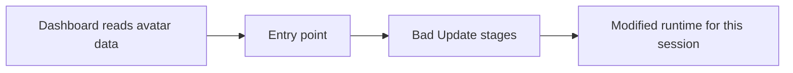

# ABadAvatar

**Role:** avatar-based entry point combined with Bad Update. **Checked:** 29 October 2026, distinguishing shutterbug2000's original project from bibarub's **v1.3-beta** port.

ABadAvatar moves the initial trigger into the Xbox 360 dashboard's avatar/profile handling. The original project requires the appropriate avatar system data and a separately selected runtime payload. It is more than a new filename for the game route, but it still relies on later Bad Update stages for privileged execution. [Original project](https://github.com/shutterbug2000/ABadAvatar)

## Automatic triggering and persistence

A trigger reached during normal profile selection can appear similar to a persistent softmod. The distinction is where state survives: avatar/profile files may remain on storage, while the modified kernel and hypervisor state must be recreated after reboot.

This shows the dependency chain, not steps for configuring a console. [Peer Pressure](../PEER_PRESSURE_GUIDE.md) uses a different startup mechanism with its own hardware and storage requirements.

## Keep the releases separate

**bibarub's v1.3-beta** ports shutterbug2000's avatar entry point onto Bad Update v1.3. It adds support for several storage locations, but its notes still report approximately **95% success** and say a connected Kinect can substantially reduce reliability. These are the fork author's observations, not universal measurements. They also show why Bad Update v1.3's theoretical reliability statement cannot simply be copied onto an avatar-based derivative. [Port and known issues](https://github.com/bibarub/Xbox360BadUpdate/releases/tag/avatar-v1.3-beta)

[ConsoleMods' overview](https://consolemods.org/wiki/Xbox_360:Bad_Update) explains the avatar-data dependency. Having dashboard version 17559 is not, by itself, proof that every required component is present. Nor does a successful trigger establish that the selected homebrew or plugin is compatible.

Credit goes to **shutterbug2000** for ABadAvatar, **Grimdoomer** for Bad Update, and **bibarub** for the v1.3-beta port, with the testers credited in that release. See [Bad Update](BAD_UPDATE.md) and the [exploit overview](../XBOX360_MODDING.md) for the surrounding security boundaries.
