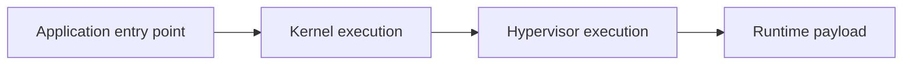

# Bad Update

**Role:** software exploit chain reaching hypervisor control. **Checked:** 29 October 2026, including upstream **v1.3**.

Bad Update gives an Xbox 360 temporary privileged execution through software. Grimdoomer's provided builds target dashboard **17559**, including Winchester. Its modified runtime ends at shutdown or reboot; another trigger is needed for the next session. [Upstream project](https://github.com/grimdoomer/Xbox360BadUpdate)

## How the stages differ

The historical chain begins with control inside a game, then obtains kernel execution and attacks the hypervisor. Its hypervisor stage targets mutable **LZX decompression state** while a signed bootloader-update payload is being processed. The issue is not simply an unsigned update file passing signature verification. The signed input and the temporary state used to decode it have different protection requirements. [Original stage description](https://github.com/grimdoomer/Xbox360BadUpdate/wiki/Exploit-Details#stage-3-hypervisor-code-execution)

This diagram separates the levels of control. The payload determines which homebrew features become available; obtaining privileges alone does not provide a dashboard, plugin system or Linux installation.

## Version matters

**v1.3** uses Rock Band Blitz and drops Tony Hawk's American Wasteland. It revises the earlier chain, including stage-two execution and stage-three improvements. The release describes immediate execution with *theoretical* 100% reliability. That is the author's qualification, not a measured guarantee for every console. The same notes warn that the published v1.3 source needs adjustments before it will compile. [v1.3 release](https://github.com/grimdoomer/Xbox360BadUpdate/releases/tag/BadUpdate-v1.3)

[ConsoleMods](https://consolemods.org/wiki/Xbox_360:Bad_Update) also covers avatar-based variants. Keep their release names separate: an improved entry point does not automatically inherit every upstream result. A temporary exploit can also launch software that writes persistent changes, so “temporary” describes the exploit's runtime state, not everything a payload might do.

Credit goes to **Grimdoomer**, with **kmx360** credited for v1.3 stage-three improvements. See [DaTArrest](DATARREST.md), [ABadAvatar](ABADAVATAR.md), the [exploit overview](../XBOX360_MODDING.md), and [Peer Pressure](../PEER_PRESSURE_GUIDE.md) for the separate persistent startup mechanism.
