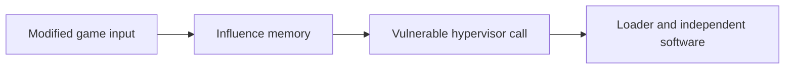

# King Kong and the original hypervisor exploit

> **Legacy** — A historical route for vulnerable 4532/4548 kernels. These prerequisites do not describe a current retail dashboard; see [Bad Update](BAD_UPDATE.md) for the newer software chain.

The King Kong chain brought early Xbox 360 homebrew from a modified game into the machine's privileged security layer. It is useful history because it clearly separates **delivery**, **privilege escalation**, and **the software launched afterward**.

**Historical account checked 29 October 2026.** This page explains the chain, not how to reproduce it.

## How the pieces fit

A modified shader in *Peter Jackson's King Kong* supplied a way to influence memory. A separate bug in the hypervisor's system-call handling then made privileged execution possible. The underlying mistake was inconsistent handling of a value's width: a check considered only part of the value later used to locate a handler. This bypassed an intended security boundary; it did not recover M$'s signing key. [Original vulnerability advisory](https://seclists.org/bugtraq/2007/Feb/514)

The arrows describe capabilities, not installation steps. XeLL could provide the loader after exploitation. The historical delivery method also needed the optical drive to accept a modified disc. That explains the connection to [DVD modifications](DVD_MODS.md), which alone did not grant CPU-side homebrew execution. [Preserved King Kong guide](https://github.com/Free60Project/wiki/blob/master/docs/Hacks/King_Kong_Hack.md)

## Compatibility and persistence

The vulnerable kernels are **4532 and 4548**. Versions before 4532 did not contain this particular bug; **4552** fixed it in January 2007. An old-looking dashboard or an early manufacturing date does not prove the required software is running. [Advisory chronology](https://seclists.org/bugtraq/2007/Feb/514)

This was a session-based route. Restarting meant reaching the exploit again. The later [JTAG/SMC chain](JTAG.md) reused the earlier vulnerability through a different startup mechanism, removing the repeated game-disc trigger. [Free60's SMC account](https://free60.org/Hacks/SMC_Hack/)

Credit belongs to the original hypervisor researchers, including Felix Domke/tmbinc, and the Free60 developers who built and documented the surrounding homebrew tools. See the [timeline](../EXPLOIT_TIMELINE.md) for disclosure dates and the [atlas](../XBOX360_MODDING.md) for the wider history.
