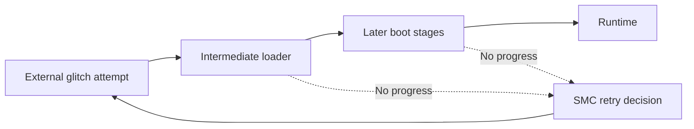

# RGH1.3

> **Beta** — A newer experimental branch, not a guaranteed improvement over a working installation. Support and remaining issues follow the author’s current release.

RGH1.3 combines an external glitch chip with an **RGH3-derived loader arrangement and closer boot monitoring**. Its goal is to waste less time on failed attempts while retaining the timing precision of dedicated glitch hardware.

**Beta project checked 29 October 2026.** Its author does not guarantee better boots on every console.

## Why another branch exists

A failed glitch can cost more than the time spent delivering the pulse. The console may wait for a timeout before trying again. RGH1.3 monitors more of startup and resets sooner when progress stops. Its intermediate loader also changes how soon the initial attempt can occur. [Author's design history](https://github.com/wurthless-elektroniks/RGH1.3/blob/main/storytime.md)

This sketch shows responsibilities, not exact firmware control flow. A quicker retry improves the cost of failure; it is not proof that every attempt succeeds.

## Scope and limitations

The project documents **Falcon/Jasper RGH1.3** and the related **Xenon/Zephyr EXT+3** route. Slim support is not presented as implemented. The current README calls the project beta, records remaining issues, and says consoles already booting consistently with RGH1.2 may gain little. [Current project account](https://github.com/wurthless-elektroniks/RGH1.3/blob/main/readme.md)

A persistent installation still depends on compatible hardware, flash and runtime. It repeats the attack at startup; it does not convert the console to an ordinary unrestricted PC. Experimental timing or boot changes deserve their own evidence rather than inheriting the reputation of the older method.

Credit **wurthless-elektroniks**, the project author, and the credited contributors including **15432, Octal450, GliGli, Tiros and cOz**. Compare [RGH1.2](RGH12.md), [RGH3](RGH3.md), and [EXT+3](EXT_PLUS3.md); the [atlas](../XBOX360_MODDING.md) places them in the wider family.
