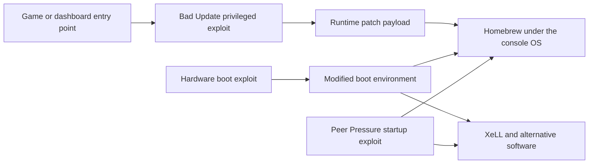

<!-- Generated from docs/XBOX360_MODDING.md; edit the canonical chapter and run npm run skills:sync. -->
<!-- Source SHA-256: 5b33be32f99b638ef4ab47afffe9ef87647f8c2940a1a822c69536a5cb0b0290 -->

# Xbox 360 exploit atlas

**Field guide · checked 2026-10-29.** This explains the major public exploit families, the security boundary each crosses, and the homebrew environment each can provide. It covers mechanisms and compatibility, not installation procedures. Release-specific source links matter: a familiar exploit name can cover several implementations with different limits.

Read alongside the [exploit timeline](timeline.md), [NAND guide](https://github.com/s33G/x360/blob/main/docs/NAND_EXPLAINED.md), [Peer Pressure guide](https://github.com/s33G/x360/blob/main/docs/PEER_PRESSURE_GUIDE.md), and [custom firmware guide](https://github.com/s33G/x360/blob/main/docs/CUSTOM_FIRMWARE.md).

For a community-maintained overview, see **ConsoleMods' [Getting Started](https://consolemods.org/wiki/Xbox_360:Getting_Started) and [Exploit Chart](https://consolemods.org/wiki/Xbox_360:Exploit_Chart)**. The explanations below pair that practical reference with the original research and release-specific developer documentation.

## Detailed pages

**Legacy** marks historical prerequisites, superseded implementations or retired entry points. It does not mean an existing installation has stopped working. **Beta** identifies experimental releases. JTAG remains a useful option on eligible early consoles; age alone does not make a method obsolete.

- **Current software and entry points:** [Peer Pressure](https://github.com/s33G/x360/blob/main/docs/PEER_PRESSURE_GUIDE.md) · [Bad Update](https://github.com/s33G/x360/blob/main/docs/exploits/BAD_UPDATE.md) · [DaTArrest](https://github.com/s33G/x360/blob/main/docs/exploits/DATARREST.md) · [ABadAvatar](https://github.com/s33G/x360/blob/main/docs/exploits/ABADAVATAR.md)
- **Glitch methods, newer variants first:** [RGH1.3 — Beta](https://github.com/s33G/x360/blob/main/docs/exploits/RGH13.md) · [EXT+3 — Beta](https://github.com/s33G/x360/blob/main/docs/exploits/EXT_PLUS3.md) · [RGH3](https://github.com/s33G/x360/blob/main/docs/exploits/RGH3.md) · [RGH1.2 / V2](https://github.com/s33G/x360/blob/main/docs/exploits/RGH12.md) · [EXT_CLK](https://github.com/s33G/x360/blob/main/docs/exploits/EXT_CLK.md) · [Mufas](https://github.com/s33G/x360/blob/main/docs/exploits/MUFAS.md) · [S-RGH / V3](https://github.com/s33G/x360/blob/main/docs/exploits/SRGH.md)
- **Legacy glitch methods:** [Muffin](https://github.com/s33G/x360/blob/main/docs/exploits/MUFFIN.md) · [R-JTOP](https://github.com/s33G/x360/blob/main/docs/exploits/RJTOP.md) · [R-JTAG](https://github.com/s33G/x360/blob/main/docs/exploits/RJTAG.md) · [RGH2](https://github.com/s33G/x360/blob/main/docs/exploits/RGH2.md) · [RGH1](https://github.com/s33G/x360/blob/main/docs/exploits/RGH1.md)
- **Legacy software research:** [King Kong](https://github.com/s33G/x360/blob/main/docs/exploits/KING_KONG.md) · [Timing attack](https://github.com/s33G/x360/blob/main/docs/exploits/TIMING_ATTACK.md) · [Tony Hawk's Pro Strcpy](https://github.com/s33G/x360/blob/main/docs/exploits/TONY_HAWK.md)
- **Other hardware paths:** [JTAG / SMC — eligible early consoles](https://github.com/s33G/x360/blob/main/docs/exploits/JTAG.md) · [DVD firmware and optical-drive emulators](https://github.com/s33G/x360/blob/main/docs/exploits/DVD_MODS.md)
- **Post-exploit payloads:** [FreeMyXe](https://github.com/s33G/x360/blob/main/docs/exploits/FREE_MY_XE.md) · [XeUnshackle](https://github.com/s33G/x360/blob/main/docs/exploits/XEUNSHACKLE.md) · [Bad Storage](https://github.com/s33G/x360/blob/main/docs/exploits/BAD_STORAGE.md)

## First, separate four different things

An **entry point** gives an attacker some control inside a program: a game save parser or avatar renderer, for example. A **primitive** is a useful capability obtained from a bug, such as influencing memory or control flow. An **exploit chain** combines capabilities until it crosses the required security boundaries. A **payload** then uses that access to load homebrew, patch the running system, or start another operating system.

These are explanatory categories, not four mandatory executable files. Bad Update's technical documentation makes the distinction concrete: its stages progress from game-based return-oriented programming, through kernel execution, to hypervisor execution and patching. Replacing the initial game trigger does not necessarily replace the privileged exploit underneath. [Bad Update technical documentation](https://github.com/grimdoomer/Xbox360BadUpdate/wiki/Exploit-Details)

This diagram groups outcomes; it is not a complete boot sequence. The important question is always **which boundary has been crossed?** Controlling a game is different from controlling the hypervisor. Modifying a file on a disk is different from making the CPU trust it.

## The security the exploits encounter

M$ combined signed boot stages, per-console secrets, revocation through eFuses, protected memory, and a small privileged hypervisor. That gives attackers multiple obstacles: a modified bootloader may fail authentication; an older authentic version may be revoked; writable memory may not be executable. The original researchers' security presentation supplies the architectural background. [Steil and Domke's 24C3 presentation](https://media.ccc.de/v/24c3-2279-en-deconstructing_xbox_360_security)

Avoid treating “encrypted” and “signed” as synonyms. Encryption hides contents; authentication checks whether contents are trusted. Avoid treating a CPU key as a universal signing key, too. A console's secrets do not turn arbitrary code into M$-signed software. The exploits below bypass or redirect specific checks rather than recover M$'s private signing key.

## [King Kong and the original hypervisor exploit](https://github.com/s33G/x360/blob/main/docs/exploits/KING_KONG.md)

> **Legacy** — Historical software access on kernels 4532 and 4548. These prerequisites do not describe a route for modern dashboard versions.

The early software chain used a modified shader in **Peter Jackson's King Kong** to influence memory and reach a hypervisor system-call bug. The shader supplied the route in; the hypervisor bug supplied the privilege escalation; XeLL could provide the next-stage loader. This was not simply a shader “breaking RSA.” [Free60's technical account](https://free60.org/Hacks/SMC_Hack/#technical-details)

The vulnerable kernel versions were **4532 and 4548**, not every version below 4548. The original advisory dates the bug's introduction to October 2006 and its fix in **4552** to January 2007. Later consoles are not made compatible merely by copying an old dashboard onto storage. [Original advisory and chronology](https://seclists.org/bugtraq/2007/Feb/514)

The historical King Kong delivery method required a modified game disc and a way for the optical drive to accept it. The exploit was session-based, with Linux and independent code as its notable outcomes. That disc requirement explains why an optical-drive modification appears in its history without making optical-drive firmware a general homebrew exploit. [Original King Kong guide](https://github.com/Free60Project/wiki/blob/master/docs/Hacks/King_Kong_Hack.md)

## [Timing attack](https://github.com/s33G/x360/blob/main/docs/exploits/TIMING_ATTACK.md): recover a route to vulnerable software

> **Legacy** — An early bootloader downgrade technique, not a general route around later fuse and bootloader restrictions.

The historical **timing/downgrade attack** targeted authentication of early CB bootloader metadata. A bytewise comparison took different amounts of time depending on how much of an authentication value matched. Those differences leaked information about the expected value, permitting altered lockdown metadata to pass that check. This was a timing side channel, not recovery of M$'s RSA signing key.

Its purpose was to make a suitable old boot chain usable again, ultimately restoring access to the vulnerable kernels used by King Kong. It did not itself provide a homebrew runtime or undo eFuses. The preserved **December 2007** account credits arnezami and robinsod, describes older eligible machines, and identifies Falcon's revised bootloader as patched. Compatibility therefore depends on the accepted bootloader and revocation state, not just a dashboard number. [Free60's preserved timing-attack account](https://free60.org/Timing_Attack/)

## [JTAG / SMC](https://github.com/s33G/x360/blob/main/docs/exploits/JTAG.md): make the early exploit part of startup

The JTAG/SMC hack repurposed the system-management controller and the GPU's debug interface to trigger the earlier vulnerability during boot. The familiar name does not mean that retail CPU debugging was simply unlocked. A modified SMC, compatible bootloader behavior, and physical connections formed the chain; the result removed the repeated game-disc trigger. [Free60 JTAG/SMC account](https://free60.org/Hacks/SMC_Hack/)

Compatibility belongs to **early phat consoles with vulnerable bootloaders**. Dashboard **7371 or earlier is a screening clue, not sufficient proof**: the CB version and update history matter. The summer 2009 **849x** updates closed the historical route. Slim consoles are outside this original JTAG family. [Bootloader requirements](https://free60.org/Hacks/SMC_Hack/#from-scratch) · [Historical kernel table](https://free60.org/System-Software/Kernel/) · [ConsoleMods' JTAG requirements](https://consolemods.org/wiki/Xbox_360:JTAG#Requirements)

“Persistent” here means the installed hardware and flash state can repeat the chain each startup. It does not mean an unsigned bootloader has become authentic or an eFuse has been undone.

## Reset Glitch Hack: disturb a check while it executes

RGH moves the attack to early boot hardware behavior. A carefully timed reset disturbance can make a bootloader's verification operation behave incorrectly. Slowing the processor helps target that narrow interval. The original publication describes different phat and slim arrangements and credits GliGli and Tiros for the principal reverse engineering and development. [Original RGH technical account](https://free60.org/Hacks/Reset_Glitch_Hack/)

The **original RGH publication** and the **RGH1 label used in current guides** have different scope. ConsoleMods uses RGH1 for the non-Xenon phat method with PLL slowdown and a Glitch1 image, on dashboard 14699 or earlier. The original publication's separate slim path must not be inferred from an RGH1 compatibility row. [ConsoleMods' RGH1 definition](https://consolemods.org/wiki/Xbox_360:RGH/RGH1) · [RGH method comparison](https://consolemods.org/wiki/Xbox_360:RGH#RGH_Methods)

RGH names describe related implementations, not a simple ladder where the highest number is always best. Motherboard, processor revision, bootloader family, wiring, timing firmware, and image-builder support all matter. A glitch chip brand is also not an exploit: one board may run several different timing programs.

Newer implementations come first, followed by current alternatives and legacy methods. Families include later V2/V3 revisions, and several first-release dates are unverified, so this is a reading order rather than an exact release calendar. The [timeline](timeline.md) distinguishes dated events from later checkpoints.

| Family | Status | What distinguishes it | Compatibility boundary |
| --- | --- | --- | --- |
| **[RGH1.3](https://github.com/s33G/x360/blob/main/docs/exploits/RGH13.md)** | **Beta** | External glitch hardware with an RGH3-derived loader and earlier retry monitoring. | Published for Falcon/Jasper families; better boots are not guaranteed. [Author](https://github.com/wurthless-elektroniks/RGH1.3/blob/main/readme.md) |
| **[EXT+3](https://github.com/s33G/x360/blob/main/docs/exploits/EXT_PLUS3.md)** | **Beta** | The external-clock counterpart to RGH1.3. | Xenon/Zephyr; shares the project's experimental status. [Author](https://github.com/wurthless-elektroniks/RGH1.3/blob/main/readme.md) |
| **[RGH3](https://github.com/s33G/x360/blob/main/docs/exploits/RGH3.md)** | Current | Moves glitch control into modified SMC code, removing the separate glitch chip. | Physical wiring and a suitable image still matter; read the board-specific qualifications below. [Source](https://github.com/15432/RGH3) |
| **[RGH1.2 / V2](https://github.com/s33G/x360/blob/main/docs/exploits/RGH12.md)** | Current | PLL slowdown with a later boot environment; V2 refines timing and adds slim implementations. | Falcon, Jasper, Trinity and Corona appear in maintained packages. [Phat source](https://github.com/Octal450/RGH1.2-V2-Phat) · [Slim source](https://github.com/Octal450/RGH1.2-V2-Slim) |
| **[EXT_CLK](https://github.com/s33G/x360/blob/main/docs/exploits/EXT_CLK.md)** | Current | External-clock slowdown. | Published timing packages target Xenon/Zephyr. [Timing releases](https://github.com/Octal450/Timing-Files/releases) |
| **[Mufas](https://github.com/s33G/x360/blob/main/docs/exploits/MUFAS.md)** | Current | Replaces Muffin with refined SMC-assisted slowdown. | Maintained packages specify Trinity/Corona and particular glitch hardware. [Release notes](https://github.com/Octal450/Timing-Files/releases) |
| **[S-RGH / V3](https://github.com/s33G/x360/blob/main/docs/exploits/SRGH.md)** | Current | Refined slim timing and reset acceleration. | V3 timing packages specify Trinity/Corona; do not assume every older package matches. [Release notes](https://github.com/Octal450/Timing-Files/releases) |
| **[Muffin](https://github.com/s33G/x360/blob/main/docs/exploits/MUFFIN.md)** | **Legacy** | Earlier SMC-assisted slowdown with an external glitch chip. | Superseded by Mufas. [Method comparison](https://consolemods.org/wiki/Xbox_360:RGH) |
| **[R-JTOP](https://github.com/s33G/x360/blob/main/docs/exploits/RJTOP.md)** | **Legacy alternative** | Open CB fuse-check glitch combined with the JTAG route. | Still documented, but niche; author reports Falcon/Jasper testing. [Source](https://github.com/DrSchottky/R-JTOP) · [Current context](https://consolemods.org/wiki/Xbox_360:R-JTOP) |
| **[R-JTAG](https://github.com/s33G/x360/blob/main/docs/exploits/RJTAG.md)** | **Legacy** | Glitching combined with the older JTAG-style startup path. | Original specialist hardware is discontinued. [Community guide](https://consolemods.org/wiki/Xbox_360:R-JTAG) |
| **[RGH2](https://github.com/s33G/x360/blob/main/docs/exploits/RGH2.md)** | **Legacy** | Earlier Glitch2 implementations with revised bootloader arrangements. | Later variants improve practical use; support was never every Xbox 360. [Implementation](https://github.com/15432/X360ACE_RGH2) |
| **[RGH1](https://github.com/s33G/x360/blob/main/docs/exploits/RGH1.md)** | **Legacy** | Original phat PLL-slowdown/Glitch1 method in current terminology. | Non-Xenon phats on dashboard 14699 or earlier, with board-specific reliability limits. [Guide](https://consolemods.org/wiki/Xbox_360:RGH/RGH1) |

**RGH3 is chipless, not solderless.** Its current public source lists Falcon, Jasper, Trinity, Corona, and an unrefined, non-guaranteed Zephyr target. The same README warns that Falcon/Jasper may need **10–20 attempts**. “Instant boot on every board” is therefore not an accurate promise. Xenon and Winchester are not listed targets. [Current RGH3 README](https://github.com/15432/RGH3)

ConsoleMods' practical chart marks Zephyr as unsupported for RGH3. Treat the experimental source target above separately from a supported installation method. [ConsoleMods' Exploit Chart](https://consolemods.org/wiki/Xbox_360:Exploit_Chart)

**[RGH1.3](https://github.com/s33G/x360/blob/main/docs/exploits/RGH13.md) and [EXT+3](https://github.com/s33G/x360/blob/main/docs/exploits/EXT_PLUS3.md)** combine external glitch hardware with an RGH3-derived loader arrangement; EXT+3 is the external-clock counterpart for Xenon/Zephyr. The author labels the project **beta** and documents remaining problems. Their existence should inform research, not become an unconditional recommendation to replace a working installation. [Author's explanation](https://github.com/wurthless-elektroniks/RGH1.3/blob/main/readme.md)

**DGX**, **CoolRunner**, **Ace**, and **CR4** also appear in old guides. Keep hardware products separate from exploit mechanisms. The current timing collection supports DGX hardware under multiple methods; “S-RGH/DGX” is not one indivisible exploit. [Timing-package compatibility](https://github.com/Octal450/Timing-Files/releases)

## [Bad Update](https://github.com/s33G/x360/blob/main/docs/exploits/BAD_UPDATE.md): software access on the final retail dashboard

Bad Update is a **nonpersistent hypervisor exploit** released in 2025. Its provided builds target dashboard **17559**, and its FAQ confirms Winchester support. After reboot, its privileged runtime state is gone. That gives machines outside the public RGH paths a route to unsigned code, without implying that every dashboard version has a ready-made build. [Project README](https://github.com/grimdoomer/Xbox360BadUpdate) · [ConsoleMods' Bad Update overview](https://consolemods.org/wiki/Xbox_360:Bad_Update)

The original chain converts initial control into kernel execution, then attacks a signed bootloader-update payload's **LZX decompression state**. The signed update input is authenticated and held in protected memory, but the decoder's scratch state lives in encrypted memory without integrity protection. A concurrent attacker can alter that state before the hypervisor uses it, redirecting where decompressed data is written and building privileged execution from the resulting corruption. The trust failure is a race over mutable decoder state: validating the update does not authenticate every working pointer used to process it. Describing this merely as replacing an update file after validation misses that distinction. [Author's original technical explanation](https://icode4.coffee/?p=1081)

The current upstream **v1.3** release drops Tony Hawk's American Wasteland support in favor of **Rock Band Blitz**, and substantially revises the chain. The author describes instantaneous execution with *theoretical* 100% reliability; that qualification is not a measured guarantee for every console or derivative build. Older “20 minutes / 30% success” figures should be labeled historical, not copied into a current comparison. [v1.3 release notes](https://github.com/grimdoomer/Xbox360BadUpdate/releases/tag/BadUpdate-v1.3)

## Software entry points and payloads around Bad Update

| Name | Role in the chain | What it does not establish |
| --- | --- | --- |
| **[Tony Hawk's Pro Strcpy](https://github.com/s33G/x360/blob/main/docs/exploits/TONY_HAWK.md) — Legacy** | Historical Tony Hawk's American Wasteland save-game entry point. [Original technical wiki](https://github.com/grimdoomer/Xbox360BadUpdate/wiki/Exploit-Details) | A generic vulnerability in every Tony Hawk title, or current upstream v1.3 support. |
| **[DaTArrest](https://github.com/s33G/x360/blob/main/docs/exploits/DATARREST.md)** | Rock Band Blitz scripting-engine entry point by ihatecompvir and Emma / InvoxiPlayGames. Its public repository currently provides a short description and points to Bad Update's implementation. [Primary project](https://github.com/RBEnhanced/DaTArrest) | Hypervisor control by itself; it supplies an entry point for a larger chain. |
| **[ABadAvatar](https://github.com/s33G/x360/blob/main/docs/exploits/ABADAVATAR.md)** | Dashboard/avatar-based entry point connected to Bad Update, requiring the appropriate avatar system data. [Original project](https://github.com/shutterbug2000/ABadAvatar) | Permanent privileged state merely because it can trigger during profile selection. |
| **[FreeMyXe](https://github.com/s33G/x360/blob/main/docs/exploits/FREE_MY_XE.md)** | Applies runtime kernel/hypervisor patches based on xeBuild after privileged access exists. [Maintained project](https://github.com/FreeMyXe/FreeMyXe) | A standalone initial exploit or a NAND image builder. |
| **[XeUnshackle](https://github.com/s33G/x360/blob/main/docs/exploits/XEUNSHACKLE.md)** | Post-exploit application applying runtime patches and loading the DashLaunch system module. [Author's project](https://github.com/Byrom90/XeUnshackle) | Identical behavior to every hardware-modified system. |

FreeMyXe **1.2** added a loader for a subset of system plugins; **1.2.1** fixes crashes involving slow-starting plugins. Older descriptions without plugin support no longer cover those releases, but the limited loader is not evidence of universal DashLaunch plugin compatibility. [FreeMyXe 1.2.1 release notes](https://github.com/FreeMyXe/FreeMyXe/releases/tag/1.2.1)

ABadAvatar can make a session exploit feel automatic: the trigger is encountered during normal dashboard behavior. The distinction remains useful: **the trigger can remain on storage while its privileged effects must be recreated after reboot**. Also distinguish the original project from forks. Bibarub's **v1.3-beta** ports the avatar entry point onto Bad Update v1.3 and supports several storage locations, but reports roughly **95% success** and a Kinect-related limitation. [Fork's release and known issues](https://github.com/bibarub/Xbox360BadUpdate/releases/tag/avatar-v1.3-beta)

## [Bad Storage](https://github.com/s33G/x360/blob/main/docs/exploits/BAD_STORAGE.md): capability added after exploitation

Bad Storage is a runtime storage extension for the Bad Update environment. It allows up to **2 TB of internal storage** under its documented preparation and compatibility requirements. It is not a new hypervisor exploit and does not turn any arbitrary unprepared drive into a retail-compatible disk. Its author separately distinguishes it from the larger XL patches and says the module has no purpose on JTAG/RGH systems. [Bad Storage documentation](https://fatxplorer.eaton-works.com/bad-storage)

This is a useful example of why “homebrew enabled” and “all storage restrictions removed” are separate claims. The exploit grants the capability to change policy; the installed payload determines which policies actually change.

## [Peer Pressure](https://github.com/s33G/x360/blob/main/docs/PEER_PRESSURE_GUIDE.md): persistent software startup chain

Peer Pressure modifies the console's **NAND and HDD security sectors**, then uses startup DMA attacks to regain unsigned-code access. Its supported list is **Xenon, Zephyr, Falcon, Jasper, and Trinity**. Corona and Winchester have a relevant southbridge hardware fix. A mechanical SATA HDD is the supported baseline; some SSDs work, but their timing makes them a qualified case. Upstream also explicitly excludes DashLaunch and DashLaunch plugins. [Project documentation](https://github.com/grimdoomer/Xbox360PeerPressure)

Board names need translating between sources. ConsoleMods separates **Corona, Waitsburg, and Stingray**, and calls the later retail board **Barracuda (Winchester)**. Its Peer Pressure table excludes all four; this agrees with the broader Corona/Winchester exclusions used upstream. Keep these aliases in mind when identifying a console or reading older guides. [ConsoleMods' board guidance](https://consolemods.org/wiki/Xbox_360:Getting_Started) · [Peer Pressure support matrix](https://consolemods.org/wiki/Xbox_360:Peer_Pressure#Support)

This is a separate persistent mechanism, not proof that Bad Update's runtime patches survive power loss. Bad Update provides installation-time access; Peer Pressure provides the subsequent startup chain. Its initial public release is **v1.0.477, October 2026**. For its distinct compatibility and recovery model, continue to the [Peer Pressure guide](https://github.com/s33G/x360/blob/main/docs/PEER_PRESSURE_GUIDE.md). [Release](https://github.com/grimdoomer/Xbox360PeerPressure/releases/tag/v1.0.477) · [Installer documentation](https://github.com/grimdoomer/Xbox360PeerPressure/wiki/Installation)

## [Optical-drive changes](https://github.com/s33G/x360/blob/main/docs/exploits/DVD_MODS.md) are a different category

DVD firmware modifications and optical-drive emulators change how disc content is supplied or accepted. They do not, by themselves, remove the CPU's executable-signature checks. That is why a drive modification could deliver King Kong's altered data while a separate vulnerability was still needed for homebrew. [Free60 DVD-drive reference](https://free60.org/Hardware/Console/DVD_Drive/)

Homebrew means independently created software: experiments, utilities, emulators, accessibility tools, and alternative operating systems. Piracy concerns unauthorized copies or distribution of someone else's work. A platform exploit may be used for either, but they are not equivalent goals. GliGli's original RGH publication explicitly describes running XeLL and free software as its purpose. [Original RGH conclusion](https://free60.org/Hacks/Reset_Glitch_Hack/#conclusion)

When choosing further reading, record the exact **board, system version, exploit implementation, and intended payload**. Then ask whether the source demonstrates initial access, repeatable startup, or a particular homebrew feature. Those questions prevent most misleading “works on everything” comparisons.
