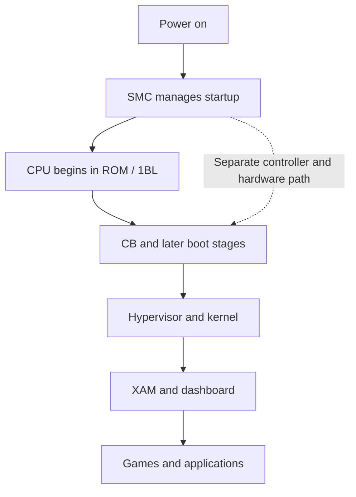

<!-- Generated from docs/BOOT_CHAIN.md; edit the canonical chapter and run npm run skills:sync. -->
<!-- Source SHA-256: 214fee8328bee476b9bdb55fa53bbf0394284a18ae7d04f04c5dac2e7912a796 -->

# Inside the boot chain

The Xbox 360 is designed to start with a small trusted foundation and extend that trust to larger pieces of software. Homebrew techniques become easier to understand when you ask **which link in that chain is being changed or bypassed**.

## The cast

| Component | Job | Why it matters |
|---|---|---|
| SMC | A small controller handling power and other system-management work | Runs separately from the main CPU; relevant to several hardware and persistent software approaches |
| 1BL | Early boot code in CPU ROM | Establishes the early CPU-side trust chain |
| CB and later boot stages | Initialize the machine and load or validate subsequent stages | Revisions and console pairing affect which attacks can work |
| Hypervisor | A privileged security layer | Controls protections that ordinary game code cannot simply switch off |
| Kernel | Provides the operating environment and system services | Patches here change the behavior available to applications |
| XAM and dashboard | System application services and the user interface | A visible custom dashboard is the end of a chain, not proof of how the chain was entered |

This is a conceptual view. Exact stage splits and update layouts vary with hardware and software revision; do not use it as a flash-memory map. The historical [Free60 boot-process reference](https://free60.org/System-Software/Boot_Process/) and [J-Runner source](https://github.com/J-Runner-With-Extras/J-Runner-with-Extras) are starting points for implementation detail.

In words: power management starts the system, ROM begins the CPU's boot chain, later stages establish the runtime, and applications run within its protections. The dotted line shows the separate hardware path that makes co-processors relevant.

## Four different ways to cross a boundary

**Attack software after startup.** A game or system parser can provide initial execution. A separate vulnerability may then be needed to reach a more privileged layer. Bad Update illustrates why those are separate steps.

**Attack an early boot decision.** The historical JTAG/SMC approach takes advantage of vulnerable early software and hardware access. Later bootloader revisions matter because the attack depends on their behavior. The [ConsoleMods JTAG guide](https://consolemods.org/wiki/Xbox_360:JTAG) makes this concrete: even dashboard 7371 or earlier is not sufficient when the CB bootloader has been patched.

**Disturb execution at the right time.** RGH is a fault-injection family. A brief electrical disturbance can make a security-sensitive operation misbehave. This is neither a recovered signing key nor a normal software configuration option. [ConsoleMods' RGH overview](https://consolemods.org/wiki/Xbox_360:RGH) separates the variants and their slowdown methods; the exact timing and supported hardware differ.

**Use another hardware participant.** Peer Pressure exploits the relationship between DMA-capable hardware and protected memory. The SMC and storage path matter to the persistent setup. [Its own chapter](https://github.com/s33G/x360/blob/main/docs/PEER_PRESSURE_GUIDE.md) explains the published account and where source visibility is limited.

The [atlas](https://github.com/s33G/x360/blob/main/docs/XBOX360_MODDING.md) supplies the sources, hardware constraints and historical context for each approach.

## Three distinctions worth keeping

**Encryption and signatures solve different problems.** Encryption hides bytes; authentication checks whether bytes should be trusted. Being able to decrypt a console-specific structure does not grant the platform's authority to sign new software.

**A CPU key belongs to one console.** It is not a universal unlock code. The NAND and Keyvault material associated with it can reveal unique identity and pairing information. Read [NAND explained](nand.md) before treating a dump as just a firmware file.

**Persistent does not mean unstoppable.** A persistent modification can still depend on a particular drive, intact flash data, boot timing and compatible software. “Retail mode” is a boot behavior, not a guarantee about online service acceptance.

Next: [Exploit atlas](https://github.com/s33G/x360/blob/main/docs/XBOX360_MODDING.md) · [Glossary](https://github.com/s33G/x360/blob/main/docs/GLOSSARY.md).
