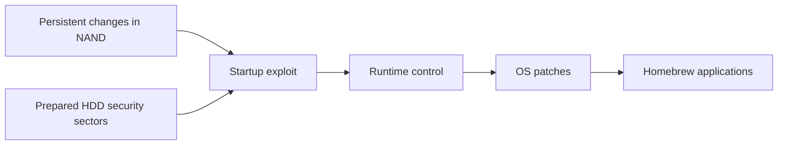

<!-- Generated from docs/PEER_PRESSURE_GUIDE.md; edit the canonical chapter and run npm run skills:sync. -->
<!-- Source SHA-256: e42a99ef29cc73e24c5cfd70a3fff238373ae438d2e37f44ef426a2422bcf31e -->

# Peer Pressure

Peer Pressure, by **Grimdoomer**, makes a supported Xbox 360 return to a homebrew-capable state when it boots. This chapter explains its startup mechanism, hardware requirements, runtime features and recovery limits.

This is an explanation, not an installation procedure. Sources were checked on **29 October 2026**, against **Peer Pressure v1.0.477**, released 7 October. [Upstream release](https://github.com/grimdoomer/Xbox360PeerPressure/releases/tag/v1.0.477).

Read alongside [the security and modding overview](https://github.com/s33G/x360/blob/main/docs/XBOX360_MODDING.md), [choosing a path](choosing-a-path.md), and [firmware, dashboards and other operating systems](https://github.com/s33G/x360/blob/main/docs/CUSTOM_FIRMWARE.md).

ConsoleMods' [Peer Pressure overview](https://consolemods.org/wiki/Xbox_360:Peer_Pressure) provides a community-maintained summary and motherboard support table. Use the original project documentation for release-specific requirements.

## What persists, and what runs again

Peer Pressure changes the console's NAND and HDD security sectors. During startup, its DMA attacks gain unsigned-code execution. Persistence means the setup survives power loss; the attack still runs during each normal boot. This is different from permanently removing the CPU's security hardware. [Upstream project](https://github.com/grimdoomer/Xbox360PeerPressure).

DMA means direct memory access: a peripheral transfers data without the CPU copying each byte. Here, the attack depends on timing during a disk-security read, so a faster disk does not necessarily make it more reliable. The diagram shows dependencies, not an installation sequence:

The first entry and later boots are separate jobs. The documented installer uses a Rock Band Blitz entry point and Bad Update. Bad Update itself is a temporary hypervisor exploit targeting dashboard **17559**: its hacked state ends at power-off. Using it to start an installer does not make Bad Update itself persistent. [Installation documentation](https://github.com/grimdoomer/Xbox360PeerPressure/wiki/Installation), [Bad Update project](https://github.com/grimdoomer/Xbox360BadUpdate).

## Hardware and timing

| Upstream board name | Peer Pressure support |
|---|---|
| Xenon, Zephyr, Falcon, Jasper, Trinity | Supported |
| Corona, Winchester | Unsupported; southbridge hardware fix |

The table retains upstream's board names. Its Corona-family exclusion includes **Waitsburg** and **Stingray**, often called Corona V3/V4 and V5/V6. **Barracuda** is called **Winchester** in upstream support lists and tools. ConsoleMods lists these boards separately and marks all four unsupported. [Motherboard names](https://consolemods.org/wiki/Xbox_360:Motherboard_Information) · [ConsoleMods support matrix](https://consolemods.org/wiki/Xbox_360:Peer_Pressure#Support)

Mechanical HDDs are recommended. Some SSDs work, but the timing-sensitive race makes compatibility uncertain. The upstream estimate is approximately five extra seconds when successful; retries and disk behaviour can add more. These are project expectations, not measurements for every console. [Compatibility and boot-time notes](https://github.com/grimdoomer/Xbox360PeerPressure#console-compatibility).

Board support, a recognised disk, and a working application are three different claims. A supported motherboard does not certify every SSD, plugin, or dashboard. Nor does a change to the visible startup animation establish that a different kernel is installed.

## What the runtime supplies

The documented patch set relaxes executable, content and region restrictions; changes memory protections; removes the system-link latency limit; and alters HDD authentication. The Xbox guide gains shortcuts for homebrew and settings. These patches run after control is obtained; they are not separate exploits. The author describes intended similarity to freeboot/DashLaunch patches without claiming perfect parity. [Softmod Features](https://github.com/grimdoomer/Xbox360PeerPressure/wiki/Softmod-Features).

Upstream explicitly excludes DashLaunch and DashLaunch plugin support. Features added by independent extensions do not change that support policy. [Homebrew compatibility](https://github.com/grimdoomer/Xbox360PeerPressure#homebrew-compatibility).

The settings application can choose a homebrew dashboard and a boot animation. Those are separate selections. A dashboard is an application; a boot animation is presentation during startup. OtherOS settings can select a XeLL-based target. [Softmod Settings](https://github.com/grimdoomer/Xbox360PeerPressure/wiki/Softmod-Settings).

XeLL is a loader. It prepares the CPU and launches suitable ELF software, including Linux or libxenon applications. Consequently, “boots XeLL” does not mean a complete Linux desktop, working hardware drivers, or arbitrary PC software is included. Those require their own compatible software stack. [XeLL-Reloaded](https://github.com/Free60Project/xell-reloaded).

## Boot modes describe execution state

| Upstream mode | Meaning |
|---|---|
| Normal | Default boot; exploit and configured softmod behaviour run |
| Safe | Exploit still runs; softmod settings are ignored and the M$ dashboard loads |
| Retail | Exploit is bypassed; homebrew capability is absent |
| OtherOS | Configured alternative software, such as XeLL, is selected |

Safe mode is useful for distinguishing a configuration problem from failure to obtain homebrew execution. Retail mode is useful for reasoning about recovery. Neither is an uninstall. In particular, loading a stock OS does not prove that persistent modifications have disappeared. Upstream explicitly leaves Xbox Live safety unresolved; **retail mode is not a ban-safety guarantee**. [Booting Your Console](https://github.com/grimdoomer/Xbox360PeerPressure/wiki/Booting-Your-Console).

## Older dashboard compatibility

Upstream does not plan support for installing the softmod on older kernel versions. Running an older dashboard application on an updated system is a different compatibility problem. [Maintainer response on older kernels](https://github.com/grimdoomer/Xbox360PeerPressure/issues/24).

That distinction already matters in v1.0.477. In the older-dashboard issue, Grimdoomer reports testing Blades build 4548, while also describing missing functionality. Other builds can need missing kernel exports or adaptations for changed XAM services. A screenshot of Blades is therefore evidence of one visible result, not proof that every dashboard feature or every historical build works. [Maintainer's compatibility explanation](https://github.com/grimdoomer/Xbox360PeerPressure/issues/7).

## Source availability

Grimdoomer has not published Peer Pressure's original source. His README explains that this is a free-time project, that numerous forks could reduce his motivation, and that modified releases by people unfamiliar with the design and risks could damage consoles. He also acknowledges that reverse engineering and repackaging can still happen. [Grimdoomer's explanation](https://github.com/grimdoomer/Xbox360PeerPressure#wheres-the-source-code).

**Our view:** We understand Grimdoomer's reasons for keeping the source closed. But with decompilation and reconstruction possible, withholding the original source may worsen the problem he hopes to prevent: derivative work may rely on incomplete reconstructions, and reviewers have less information with which to assess changes. We would prefer the original source to be available for study and review, with authorship and support boundaries kept clear. This is our assessment of the tradeoff, not a demonstrated outcome or a claim that publishing source would prevent unsafe forks.

## Recovery evidence and credit

The upstream backup encompasses NAND, CPU-fuse information and HDD security data. Those belong outside this repository. An example console's byte matches can establish what was observed in that sample; they cannot establish a universal patch offset, safe migration, or recovery outcome for another machine. The installer documentation describes separate console and disk components, which is why preserving only ordinary HDD files is incomplete. [Backup documentation](https://github.com/grimdoomer/Xbox360PeerPressure/wiki/Installation).

Credits: **Grimdoomer** for Peer Pressure; **ihatecompvir** and **InvoxiPlayGames** for the Rock Band Blitz entry; and **Máté** for stage-three improvements. Upstream also credits its alpha and beta testers. [Original credits](https://github.com/grimdoomer/Xbox360PeerPressure#credits).

## Research note: PeerSlop

[PeerSlop](https://gitlab.com/darkkiritov/peerslop) is an independent extension directed and hardware-tested by **DarkLimbo**, with substantial AI assistance. Its AI-assisted research and documentation helped us understand Peer Pressure while writing this guide. That contribution does not make its changes upstream features or imply endorsement by Grimdoomer. We checked its **v1.0.477-4** documentation on **29 October 2026**. [Project account](https://gitlab.com/darkkiritov/peerslop/-/raw/main/README.md)

Reconstructed and added source is not the complete original source: PeerSlop's build still retains binary modules it does not recompile. Its credits also recognise **cOz**, **951261** and **Team XeDev**. [Build scope](https://gitlab.com/darkkiritov/peerslop/-/raw/main/BUILDING.md) · [Attribution](https://gitlab.com/darkkiritov/peerslop/-/raw/main/Licenses-and-Attribution.md)
